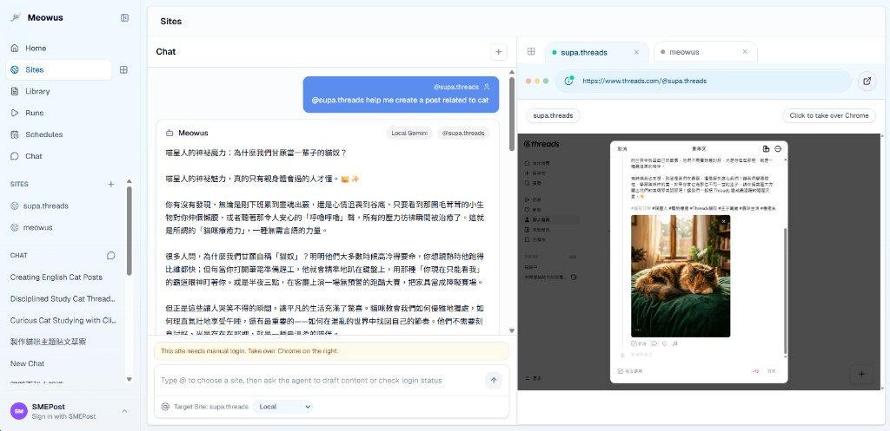

# CoolPilot

**CoolPilot** is an open-source social media agent.

Your open-source social media agent — plan, approve, schedule, and publish social campaigns from your own computer.

CoolPilot — an AI copilot that helps you manage social media.

CoolPilot is a local-first, open-source social media agent. Accounts, content, schedules, publish logs, and browser profiles all live on your own computer.

It combines a desktop Electron app, a Next.js control panel, persistent browser profiles, scheduled social posting, and an AI social media agent that can help create, manage, and run repeatable content workflows.

Use it as a local Agent OS for social media operations: connect multiple logged-in accounts, keep each account in its own browser profile, generate posts and images with your own model keys, queue work, schedule publishing runs, and let an AI agent coordinate browser actions with human approval controls.

[Traditional Chinese Taiwan README](README.zh-TW.md)

## Download and Run CoolPilot

Download the latest version from [GitHub Releases](https://github.com/Edgarmongo/CoolPilot/releases). Official releases use version tags such as `v0.1.0`.

### Windows

- **Installer (`CoolPilot Setup <version>.exe`)**: Download and run the installer, then open CoolPilot from the Start menu.
- **Portable ZIP (`CoolPilot-Windows-x64.zip`)**: Extract the entire ZIP to a permanent folder, then open `CoolPilot.exe` inside `win-unpacked`. Do not move the executable out of that folder because it needs the adjacent `resources` files.
- GitHub Windows downloads are intentionally **unsigned**. Microsoft SmartScreen may display a warning; choose **More info** then **Run anyway** only if you downloaded the file from this repository's official GitHub Release.

### macOS

1. Download the `.dmg` for your Mac.
2. Open it and drag **CoolPilot** to **Applications**.
3. Open CoolPilot from Applications.

Official macOS releases are signed with Developer ID and notarized by Apple. Your local database, browser profiles, uploaded assets, and generated artifacts remain on your computer when you update the app.

## Repository

```bash
git clone https://github.com/Edgarmongo/CoolPilot.git
cd CoolPilot
```

## What It Can Do

- Run a local-first social media workflow from a desktop app or local web console.
- Manage multiple social accounts with separate persistent Chromium browser profiles.
- Let users log in to each platform account once, then reuse that session for later browser automation.
- Generate social post drafts from topics, prompts, URLs, and article content.
- Generate or attach images through configured local image providers.
- Schedule social posting runs and track run history in local SQLite storage.
- Use an AI agent workflow to create posts, generate images, open pages, click, type, capture screenshots, and draft or publish Threads posts.
- Bring your own LLM and image API keys; provider keys stay in your local settings and every agent step runs on your machine.
- Browse mainstream vendor model catalogs and manage every model provider in one place under **System → Model Management**.
- Run a headless account risk check (**Publishing → Accounts**) that verifies each saved profile can still reach its publishing page instead of hitting a login wall, and refuses to launch a browser for an account the check found signed out.
- Export the whole workspace into one JSON file and restore it later under **System Settings → Backup**, so local data stays portable and owns its own copy.
- Plan and review everything on one monthly **Content Calendar** (**Automation → Content Calendar**) that shows planned occurrences, run history, and publish logs side by side, and can turn your best-performing time slots into a weekly schedule in one click.

Current browser automation is centered on persistent per-account Chromium profiles. CloakBrowser is included as a stealth Chromium dependency, but the current app launch paths still use Playwright persistent contexts directly. Treat stealth tooling as a useful dependency, not a guarantee against platform detection.

## Interface Preview

The screenshot below is captured from the real CoolPilot app UI and sanitized with demo account names before publishing.



## Feature Labels

| Area | Package or system | What it provides |
| --- | --- | --- |
| App framework | Next.js 16 + React 19 | Local web console, App Router pages, API routes, standalone production output |
| Desktop runtime | Electron | Packaged desktop app that runs the local console and browser workflow |
| UI system | HeroUI, Tailwind CSS, lucide-react | Console layout, controls, icons, settings, chat, and content surfaces |
| Local database | SQLite/libSQL + Drizzle ORM | Sites, content, schedules, runs, events, chat threads, tool calls, and app settings |
| AI agent workflow | LangGraph/LangChain | Planning and tool execution for the local social media agent |
| Browser automation | Playwright | Persistent Chromium profiles, page navigation, screenshots, form input, and posting actions |
| Stealth browser dependency | CloakBrowser | Included stealth Chromium package for future or custom launcher alignment |
| Data fetching | SWR | Client-side refresh and state loading |
| Validation | Zod | API, tool, and settings validation |
| AI providers | Gemini, Groq, OpenAI-compatible, OpenRouter | User-supplied text model keys, model discovery, and provider fallback |
| Image providers | Gemini image, OpenAI-compatible image endpoints | Image generation for agent-created social content |

## How Users Run Multiple Logged-In Accounts

1. Create a site record for each account, such as a Threads brand account, creator account, or client account.
2. Open the browser profile from the app.
3. Log in manually inside that profile.
4. Repeat for every account you want to manage.
5. Use the chatroom `@` selector or the schedule/run screens to target the correct account.
6. Let the worker or AI agent execute against that account's saved profile.

Each site keeps its own profile path under the local data directory. Cookies, local storage, and account sessions stay separated by profile, which is the foundation for multi-account browser automation.

## AI Agent Workflow

The agent can work like a marketing operations assistant for social media:

- draft a post from a topic or campaign idea
- turn a URL into a social-ready post
- generate an image prompt and image file
- reuse the latest post/image context in the same chat
- open a selected account profile
- draft or publish a Threads post
- create scheduled posting tasks

Permission controls let you choose whether actions run automatically or ask for confirmation. Final publishing actions should stay in confirm mode unless you deliberately trust the workflow.

### Example Generated Post Content

```text
Turn one focused study session into a small win today.

Clip a useful lesson, write down one takeaway, and share the insight
while it is still fresh. CoolPilot helps your agent prepare
the draft, pair it with an image concept, and schedule the post for
the right account without mixing browser profiles.

#AISocialMediaAgent #ScheduledPosting #LocalFirstAutomation
```

### Agent Tools

| Tool | What it does |
| --- | --- |
| `generate_social_post_draft` | Creates a social post draft from a topic, prompt, selected site, language, and brand context, then stores it as local content. |
| `generate_image_prompt` | Turns the post context into a production-ready image prompt with subject, composition, style, lighting, and aspect ratio. |
| `generate_image_file` | Calls the configured local image provider and saves the generated image as a local artifact. |
| `browser_open_page` | Opens a URL in the selected local browser profile or site browser panel. |
| `browser_click` | Clicks a selector in the active browser session, with stricter approval when the action is a final publish step. |
| `browser_type` | Types or fills text into the selected browser page. |
| `browser_screenshot` | Captures the active browser page and saves the screenshot as an artifact. |
| `threads_create_post` | Drafts or publishes a Threads post through the selected local browser profile. |

The chat layer can also turn natural-language timing requests into scheduled Threads posts when a matching site, post context, and publish authorization are available.

## Local-Only Runtime

CoolPilot runs entirely on your own machine with your own API keys. Model providers, local data, and browser sessions all stay under your control.

There is no cloud runtime, no account requirement, and no managed credit system: configure the model keys you want under **System → Model Management**, and every agent step runs locally against those providers.

## Supported Providers

Text generation:

- Gemini
- Groq
- OpenAI-compatible APIs
- OpenRouter

Image generation:

- Gemini image models
- OpenAI-compatible image generation endpoints

Model lists can be loaded from provider APIs when keys are configured. You can also pin model IDs through environment variables or the settings UI.

**System → Model Management** is the single place for model work. The *Available Models* tab lists every model id your model gateway serves (imported from `quanzil.com/api/user/models`, 420 ids at import time) grouped by vendor and capability, with the OpenAI-compatible endpoint for each documented vendor; the *Model Configuration* tab holds the local provider keys, endpoints, and model choices.

### Syncing your own gateway account

The *Available Models* tab ships a **Gateway model sync** switch. While it stays off, the page serves the snapshot bundled with the app. To track your own account instead:

1. Turn the switch on.
2. Paste the `Cookie` header value of your logged-in gateway session into **Account session cookie** and press **Save settings**.
3. Press **Sync models**.

The sync calls the endpoint shown in the card (default `https://quanzil.com/api/user/models`), stores the returned ids in the local database and switches the catalog to that list straight away - no rebuild, and nothing is written back into the source tree (packaged Electron builds are read-only). **Clear credential and restore bundled list** drops both the synced list and the cookie. The endpoint must answer with `{"data":["model-a","model-b"]}` or a bare array of model ids.

The cookie is sent to that endpoint only and is kept on this machine in `.env.local` next to your provider keys (override it with the `MODEL_GATEWAY_COOKIE` environment variable if you prefer) - never in the database, the logs or the repository. A failed attempt is reported in the card and the catalog keeps serving the last good list.

To refresh the snapshot bundled with the app (used while the switch is off):

```bash
# Save the raw JSON body of the gateway model request ({"data":["model-a", ...]}) to a file first.
tsx scripts/import-gateway-models.ts ./gateway-models.json --source=quanzil.com/api/user/models
```

The importer only reads public model ids; never pass a payload that contains cookies, tokens or account data (use the in-app sync above for credentialed requests).

To verify the page renders in a real browser (needs a running dev server):

```bash
tsx scripts/model-management-smoke.ts http://127.0.0.1:3000 zh-cn
```

## Requirements

- Node.js 20.9 or later
- pnpm
- Playwright Chromium for browser automation
- Windows, macOS, or Linux

## Quick Start

```powershell
pnpm install
Copy-Item .env.example .env.local
pnpm exec playwright install chromium
pnpm dev
```

Start the worker in a second terminal:

```powershell
pnpm worker
```

Open:

```text
http://127.0.0.1:3000
```

## Environment Setup

At minimum:

```env
SOCIAL_AUTO_POST_DB_URL=file:./web-data/social-auto-post.db
SOCIAL_AUTO_POST_LOCAL_TOKEN=change-this-local-token
```

Add the providers you want to use:

```env
GEMINI_API_KEYS=
GEMINI_MODEL=
GEMINI_BASE_URL=https://generativelanguage.googleapis.com
GEMINI_IMAGE_MODEL=

GROQ_API_KEYS=
GROQ_MODEL=
GROQ_BASE_URL=https://api.groq.com/openai/v1

OPENAI_API_KEYS=
OPENAI_MODEL=
OPENAI_BASE_URL=https://api.openai.com/v1
OPENAI_IMAGE_MODEL=
OPENAI_IMAGE_SIZE=

OPENROUTER_API_KEYS=
OPENROUTER_MODEL=
OPENROUTER_BASE_URL=https://openrouter.ai/api/v1
```

Every `*_API_KEYS` variable accepts several keys separated by commas or newlines. The AI
runtime rotates through them and cools a key down when a provider answers `429`, so one
rate-limited key does not take the provider offline. The same keys can be managed per
provider under **系统 / 模型管理 → 供应商与密钥**, where they are stored in the local
encrypted vault instead of the environment file (see `docs/model-runtime.md` §5).

## Common Commands

```powershell
pnpm dev
pnpm worker
pnpm build
pnpm start
pnpm test
pnpm typecheck
pnpm lint
pnpm electron:pack
pnpm electron:build
pnpm electron:dry-run
pnpm db:generate
pnpm db:studio
```

If `pnpm` is blocked by ignored build-script policy in a local environment, direct binaries can still verify the repo:

```powershell
node_modules\.bin\tsc.cmd --noEmit
node_modules\.bin\vitest.cmd run
node_modules\.bin\eslint.cmd .
```

## Runtime Data

Local runtime files are stored under `web-data/` by default:

- `web-data/social-auto-post.db` for SQLite data
- `web-data/browser-profiles/` for logged-in account profiles
- `web-data/uploads/` for uploaded assets
- `web-data/artifacts/` for generated images, screenshots, and agent artifacts

Override the data directory with `SOCIAL_AUTO_POST_DATA_DIR` or `APP_DATA_DIR`.

### Backup and restore

**System Settings → Backup** exports every table in `web-data/social-auto-post.db` into a single `coolpilot-backup-<date>-<time>.json` file (`GET /api/backup/export`) and writes it back later (`POST /api/backup/restore`):

- `replace` clears the tables contained in the file and imports them, so the workspace becomes an exact copy of the backup.
- `merge` keeps existing rows and skips records whose primary key is already present.

Files are validated before anything is written, and an unknown table or column is skipped with a warning instead of failing the whole restore. Browser profiles, uploads, videos, and artifacts are **not** part of the JSON file — copy those folders as well when moving to another machine, then sign in again if a profile path changed.

Do not commit `.env.local`, `web-data/`, browser profiles, database files, uploaded assets, generated artifacts, or logs.

## Content Calendar

**Automation → Content Calendar** (`/schedules/calendar`, backed by `GET /api/calendar`) is the monthly planning view. It merges three layers for any date range and lets you hide each one:

- **Scheduled** — every occurrence the schedule rules produce (including paused schedules, drawn struck through).
- **Run history** — queue/running/success/warning/failed runs from `runs`.
- **Publish logs** — what actually went out, from `publish_records`.

Schedules support five recurrence rules, and the next run is the earliest occurrence across all of them (`src/lib/schedule.ts`):

| Type | Payload | Behaviour |
| --- | --- | --- |
| `once` | `{ type: "once", at }` | One absolute ISO moment |
| `daily` | `{ type: "daily", time }` | Every day at `HH:MM` local time |
| `weekly` | `{ type: "weekly", time, weekdays }` | Every listed weekday (0 = Sunday … 6 = Saturday) |
| `monthly` | `{ type: "monthly", time, days }` | Every listed day (1–31); a day past a short month's length uses that month's last day |
| `interval` | `{ type: "interval", everyMinutes, anchor? }` | Every N minutes, aligned to `anchor` when given |

The right-hand column ranks your **best publishing times** from real engagement (`bestTimeSlots`). Select one or more weekday/hour slots and **Create schedule from selected slots** turns them into weekly rules in a single schedule, so the calendar and the performance data stay connected.

Week grids start on Monday, and the day panel lists each entry with its time, layer, status, account, and playbook.

## Project Structure

```text
src/app/          Next.js pages and API routes
src/components/   Console UI and feature components
src/db/           SQLite schema, client, and repositories
src/lib/          AI, browser, agent, schedule, and utility logic
src/worker/       Queue and schedule worker
electron/         Electron entrypoints
scripts/          Build and packaging helpers
public/           Public assets
docs/             Model layer docs (model-gateway.md · model-gateway-plan.md · model-layer-spec.md · model-runtime.md · generate-migration.md) + tech stack (tech-stack.md)
```

## Safety and Platform Disclaimer

This software controls browsers and can interact with third-party social media platforms. Using automation, multi-account workflows, scraping, posting tools, or stealth browser technology may violate a platform's terms of service or automation policies.

Your accounts may be challenged, rate-limited, restricted, suspended, or banned by social media providers. CloakBrowser or any stealth Chromium tooling cannot guarantee that automation will avoid bot detection, CAPTCHA, device checks, review systems, or enforcement actions.

Use CoolPilot only on accounts you own or are authorized to manage. Do not use it for spam, impersonation, deceptive engagement, credential abuse, platform manipulation, or any illegal activity. You are responsible for reviewing platform rules and local laws before running automated workflows.

## License

MIT. See [LICENSE](LICENSE).
