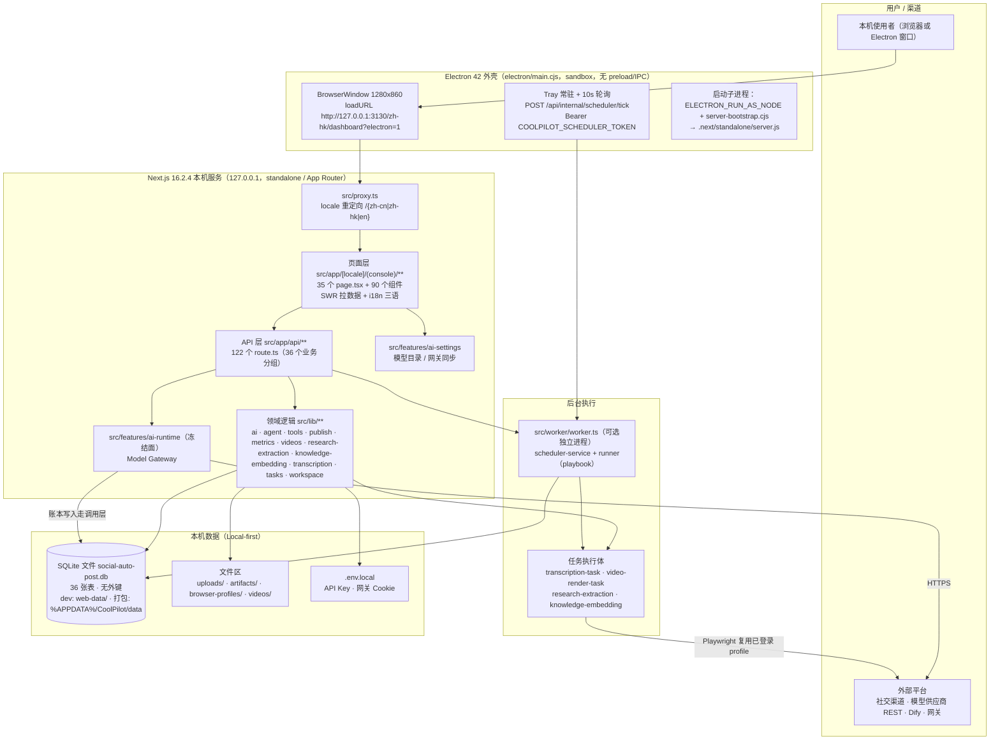
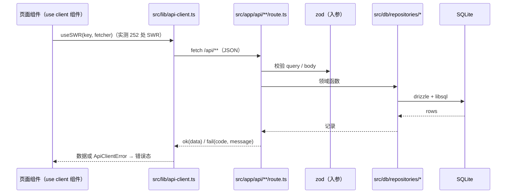
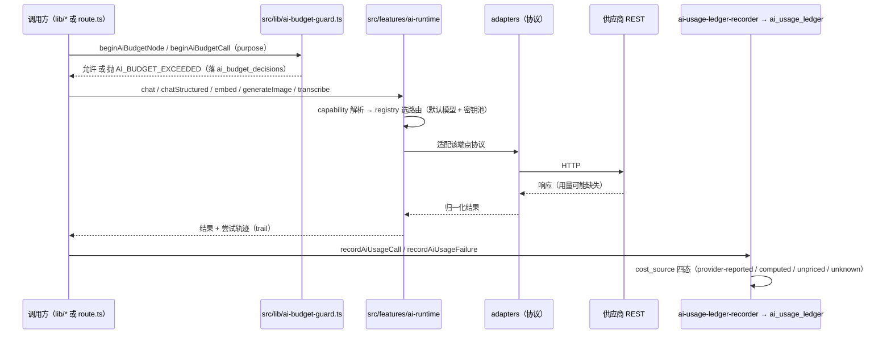
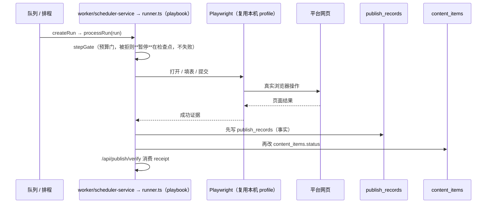
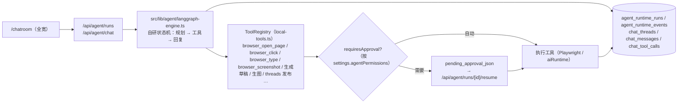
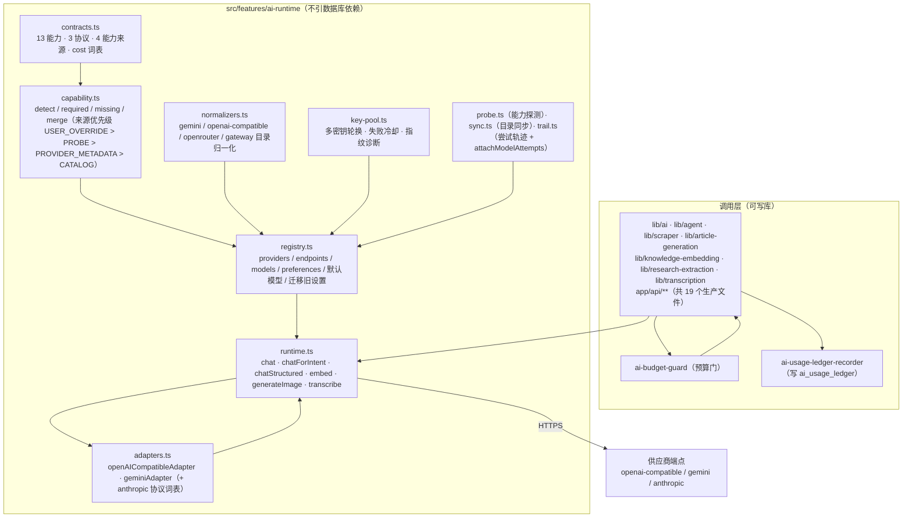
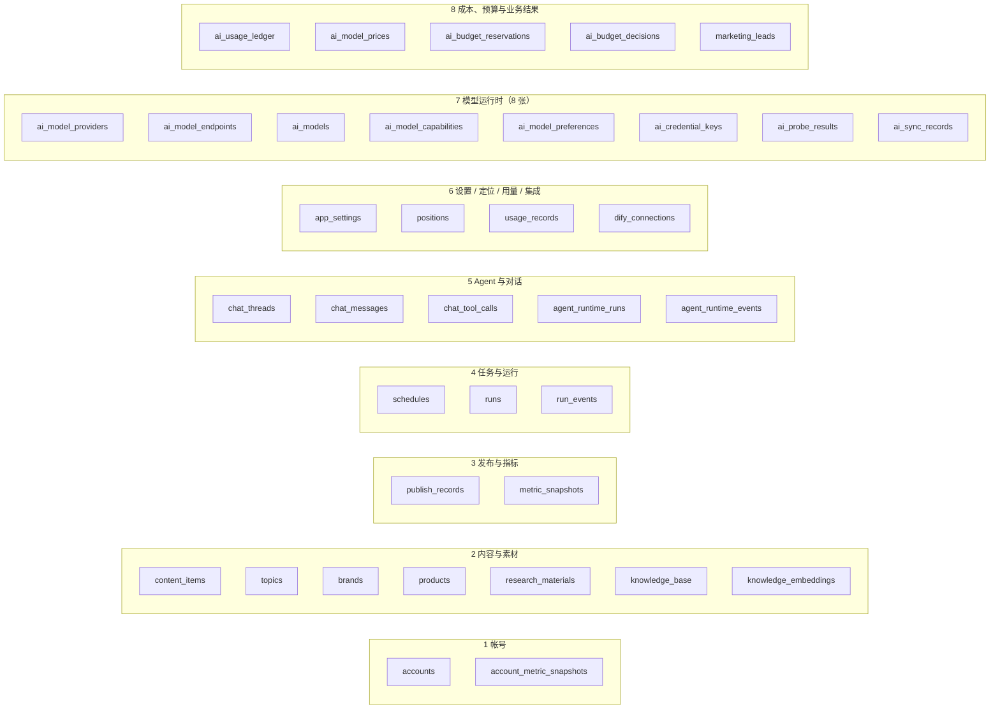
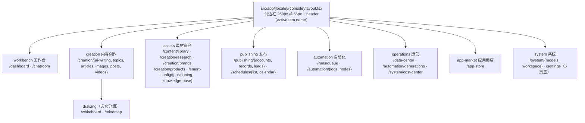

# CoolPilot 架构与技术栈总览（Architecture & Tech Stack Overview）

> **实测基线**：2026-10-12，工作区 HEAD `2412d7c`（`feat: land C4 image identity, model runtime and creator workflow cards`）。
> 本文**所有数字都是本轮实际命令的输出**（命令见 §10），不含「通常这种项目会用 X」的推断。
> 与既有文档不一致的地方**只报告、不代改**（见 §9 漂移核对表）。
>
> 配套文档：`docs/tech-stack.md`、`docs/data-model-inventory.md`、`docs/menu-inventory.md`、`docs/coolpilot-integration-contracts.md`、`docs/coolpilot-capability-integration-plan.md`（进度唯一来源）。

---

## 0. 一句话

**Electron 42 外壳 + Next.js 16.2.4（App Router / standalone）+ React 19.2.4 + SQLite（libsql）+ Drizzle + Tailwind v4 + SWR + Zod + Vitest**；AI 侧是**自研 Model Gateway（`src/features/ai-runtime`，冻结面）直连供应商 REST**（`openai-compatible` / `gemini` / `anthropic` 三种协议），Agent 是**自研状态机引擎**（`langgraph-engine.ts`，不依赖 `@langchain/langgraph`）；浏览器自动化用 **Playwright** 复用本机已登录 profile；白板 / 思维导图是 **Plait / Drawnix / Slate 的 vendored fork**。

数据全部落在本机：**无外键、无云运行时、无账号体系、无托管额度**。

---

## 1. 技术栈清单（分层，含实测用量）

### 1.1 语言与运行时

| 技术 | 版本 / 配置 | 实测证据 |
| --- | --- | --- |
| TypeScript | `^5`；`strict`、`noEmit`、`target ES2017`、`moduleResolution bundler`、`jsx react-jsx`、`incremental` | `tsconfig.json`；别名 `@/* → ./src/*` |
| Node.js | `engines >= 20.9.0` | `package.json`；Next standalone 直接跑 |
| CommonJS | `.cjs` × 2 | 仅 `electron/main.cjs`、`electron/server-bootstrap.cjs` |
| Sass | `sass ^1.101.0` | **24 个 `.scss` 全在 `src/whiteboard/**`**（vendored） |
| CSS | 1 个 | `src/app/globals.css`（Tailwind v4 入口） |
| i18n 资源 | `src/locales/{en,zh-cn,zh-hk}.json`（各 2557 行，键集一致） | `src/lib/i18n-coverage.test.ts` 强制 |

**实测规模**（`src` + `scripts` + `electron`）：`.ts` **566** / `.tsx` **203** / `.scss` 24 / `.json` 3 / `.cjs` 2 / `.css` 1 / `.mjs` 1 / `.ico` 1；合计 **约 131,423 行**。其中组件 `src/components/**/*.tsx` **90** 个、页面 `page.tsx` **35** 个、API `route.ts` **122** 个、测试 `src/**/*.test.ts` **181** 个。

### 1.2 应用框架

| 技术 | 版本 | 实测用法 |
| --- | --- | --- |
| Next.js | `16.2.4` | App Router；`output: "standalone"`、`devIndicators: false`、`transpilePackages`（8 个 `@plait/*`）、`outputFileTracingExcludes`（排除 `web-data` / `dist-electron` / playwright 产物） |
| React / ReactDOM | `19.2.4` | Server Components + `"use client"` 混合 |
| **`src/proxy.ts`** | — | Next 16 的 **`proxy.ts`（不是 `middleware.ts`）**：把无前缀路径重定向到 `/{defaultLocale}/…`；`matcher: ["/((?!_next|api).*)"]`；已确认 `src/middleware.ts` **不存在** |
| 自研 API 约定 | — | `src/lib/api.ts`（`ok`/`fail`/`parseJson`）、`src/lib/app-errors.ts`（`AppErrorCode` + `AppError`）、`src/lib/api-client.ts`（`apiGet`/`apiPost`/`apiPatch`/`apiDelete` + `ApiClientError`） |
| 客户端数据获取 | `swr ^2.4.1` | `from "swr"` 实测 **252** 处（页面/面板层统一用 SWR 拉 `/api/**`） |
| 校验与 schema | `zod ^4.3.6` | 实测 **67** 处；路由入参、工具入参、AI 结构化输出都过 zod |
| 图标 | `lucide-react ^1.8.0` | 实测 **80** 处（含导航图标表 `src/lib/console-nav.ts`） |
| 类名合并 | `classnames ^2.5.1`（76）+ `clsx ^2.1.1`（5） | 两套并存 |
| 动效 | `framer-motion` **声明但零引用** | 动画走 CSS transition |

### 1.3 数据与持久化

| 技术 | 版本 | 实测用法 |
| --- | --- | --- |
| SQLite via libsql | `@libsql/client ^0.17.2` | `src/db/client.ts`：`createClient({ url })` + `drizzle(sqlite, { schema })` |
| Drizzle ORM | `drizzle-orm ^0.45.2` | `src/db/schema.ts`（**817 行 / 36 张表**）是唯一表定义来源 |
| drizzle-kit | `^0.31.10` | **`src/db/migrations/` 不存在**；实际建表是 `client.ts`（1060 行）里的手写 `CREATE TABLE IF NOT EXISTS` + 就地 `ALTER TABLE` |
| 锁与并发 | `sqliteBusyTimeoutMs = 5000` | 应用 / worker / 第二实例共用同一个库文件，写者**等锁**而不是失败（CI-P7-03-A） |
| 仓储层 | 自研 | `src/db/repositories/*`（**29 个模块**，含 5 个 `.test.ts`）+ `src/db/repository.ts` 汇总导出 |
| 数据库位置 | `src/lib/paths.ts` | dev → 仓库内 `web-data/social-auto-post.db`；打包 → `%APPDATA%\CoolPilot\data`；`SOCIAL_AUTO_POST_DB_URL` 可覆盖 |

### 1.4 AI 层（`src/features/ai-runtime`，**冻结面**）

| 项 | 实测 |
| --- | --- |
| 分层 | `contracts` / `capability` / `normalizers` → `adapters`（协议）→ `registry`（供应商·端点·模型·偏好）→ `router` → `aiRuntime`；旁挂 `key-pool`（密钥池与冷却）、`probe`（能力探测）、`sync`（目录同步）、`trail`（尝试轨迹） |
| 协议 | `openai-compatible` / `gemini` / `anthropic`（协议属于**端点**，不属于供应商） |
| 能力词表 | 13 项：`chat`、`reasoning`、`vision`、`audio_input`、`audio_output`、`tool_calling`、`structured_output`、`image_generation`、`video_generation`、`text_to_speech`、`speech_to_text`、`embedding`、`rerank` |
| 对外函数 | `chat` / `chatForIntent` / `chatStructured` / `embed` / `generateImage` / `transcribe` |
| 生产调用点 | **19 个非测试文件**（不含 `ai-runtime` 内部 11 个非测试文件与 `src/test/route-harness.ts`）：`lib/scraper.ts`、`lib/article-generation.ts`、`lib/agent/{langgraph-engine,local-tools,image-generation,chat-thread-title}.ts`、`lib/knowledge-embedding/{recall,embedding-task}.ts`、`lib/research-extraction/extraction-task.ts`、`lib/transcription/{providers,transcription-task}.ts`，以及 `api/{ai/chat, images, content/[id]/rewrite, content/[id]/translate, content/mindmap, knowledge-base/ai-parse, metrics/insights, positions/generate}` |
| 成本账本 | `ai_usage_ledger`（每次实际请求一行）+ `ai_model_prices`（价格目录，只增不改）；`cost_source` 四态：`provider-reported` / `computed` / `unpriced` / `unknown` |
| 预算 | `src/lib/ai-budget*.ts` + `ai_budget_reservations` / `ai_budget_decisions`（预算 hold 是**一行数据**，跨进程可见） |
| LangGraph | `@langchain/langgraph` 在**代码中 0 引用**（唯一命中是 `docs/tech-stack.md:108`）；`src/lib/agent/langgraph-engine.ts` 是自研状态机 + `ToolRegistry` |

### 1.5 浏览器自动化 / 发布

| 技术 | 版本 | 实测用法 |
| --- | --- | --- |
| Playwright | `playwright ^1.60.0` + `playwright-core ^1.59.1` | 实测 28 处；`src/lib/agent/playwright-session.ts` 复用本机 Chrome profile，`src/lib/browser-preview*.ts` 提供预览面板 |
| 平台发布 | 无官方 API 依赖 | 走浏览器自动化 + `publish_records` 事实表；`recordPublishSuccess` 的写入顺序是**冻结面** |
| 网页抓取 | `cheerio ^1.2.0`（8）+ `fast-xml-parser ^5.7.1`（3） | `src/lib/scraper.ts` 等 |
| cloakbrowser | **声明但零引用** | 实际用 Playwright |

### 1.6 画布 / 编辑器（vendored fork）

`@plait/*`（core / draw / mind / layouts / common / text-plugins，64 处引用）、`slate`（175）、`roughjs`、`laser-pen`、`localforage`、`browser-fs-access`、`is-hotkey`、`mobile-detect`、`ahooks`、`react-resizable-panels`、`@floating-ui/react`、`nanoid`（62）。
落地位置：`src/whiteboard/**`（含 `drawnix` / `react-board` / `react-text` 三个子包），由 `tsconfig.json` 的 `@drawnix/drawnix`、`@plait-board/react-board`、`@plait-board/react-text` 别名覆盖同名 npm 包；页面 `ssr: false` 动态载入。

### 1.7 Electron 与打包

| 项 | 实测 |
| --- | --- |
| Electron | `electron ^42.3.3`（devDependency）；入口 `electron/main.cjs`（`extraMetadata.main`），另有 `electron/server-bootstrap.cjs` |
| 打包 | `electron-builder ^26.8.1`；`appId io.coolpilot.app`、`productName CoolPilot`；`asarUnpack: .next/standalone/**`；win: `dir`+`nsis`，mac: `dmg --arm64` + 公证钩子 |
| 窗口 | `1280×860`（min 980×680）、`contextIsolation: true`、`nodeIntegration: false`、`sandbox: true`、**无 preload / 无 IPC** |
| 通信 | 主进程 ⇄ Next 只能走 **loopback HTTP + Bearer token**（`COOLPILOT_SCHEDULER_TOKEN`） |
| 常驻 | 托盘（Tray）常驻；关窗只是 `hide()`；`before-quit` 才 kill 子进程 |

### 1.8 测试与工程化

| 技术 | 版本 / 配置 | 实测 |
| --- | --- | --- |
| Vitest | `^4.1.5` | `environment: "node"`、`include: src/**/*.test.ts`、`testTimeout: 15000`、`setupFiles: src/test/app-env.ts`；**无 DOM 环境**（无 jsdom / happy-dom / testing-library） |
| ESLint | `^9` + `eslint-config-next 16.2.4` | `eslint.config.mjs`；对 `electron/**/*.cjs` 关闭 `no-require-imports`；`src/whiteboard/**` 被忽略 |
| 包管理 | `pnpm@10.26.1` | `pnpm-lock.yaml`；**build scripts 被忽略** → 验证必须直连二进制（见 §10） |
| 脚本运行器 | `tsx ^4.21.0` | `scripts/*.ts` 与 `src/worker/worker.ts` |
| 构建产物 | `next build` → `.next/standalone` | `scripts/prepare-electron-bundle.ts` 摆位（含 playwright 外置处理） |
| 图标/转换 | `sharp ^0.34.5`、`opencc-js ^1.4.2` | 仅 `scripts/generate-icons.ts` 与 `scripts/convert-zh-cn.mjs`（zh-hk → zh-cn 文案转换） |
| 仓库形态 | 单包（`pnpm-workspace.yaml` 已删） | 无 monorepo |

---

## 2. 全景架构图



### 2.1 文本版（同一张图，便于贴到聊天或 PR）

```text
                        ┌──────────────────────── 用户（本机浏览器 / CoolPilot 窗口）────────────────────────┐
                        ▼
        ┌───────────────────────────────  Electron 42 外壳（electron/main.cjs）  ───────────────────────────────┐
        │ BrowserWindow(sandbox, 无 IPC)          Tray 常驻 + 每 10s tick            spawn(NODE, bootstrap)      │
        └──────────────┬───────────────────────────────────┬───────────────────────────────┬─────────────────────┘
                       │ http://127.0.0.1:3130              │ POST /api/internal/...        │ 拉起 Next
                       ▼                                    ▼                               ▼
   ┌────────────────────────────────── Next.js 16.2.4 standalone（App Router，本机） ──────────────────────────────────┐
   │  src/proxy.ts（locale 重定向）                                                                                     │
   │  ┌── 页面层 src/app/[locale]/(console)/**（35 page.tsx / 90 组件 / SWR / i18n 三语）                             │
   │  └── API 层 src/app/api/**（122 route.ts / 36 分组：ok+fail 统一封装 + zod 校验）                                  │
   │                    │                                                                                              │
   │                    ▼                                                                                              │
   │  领域逻辑 src/lib/**（publish · metrics · agent · tools · videos · research-extraction · knowledge-embedding …）   │
   │                    │                                   │                                                          │
   │        ┌───────────▼──────────┐            ┌───────────▼─────────────┐   ┌── features/ai-settings（模型目录）      │
   │        │ 仓储 src/db/**       │            │ features/ai-runtime      │   └── features/ai-runtime（冻结面）        │
   │        │ repository + repos/* │            │ 冻结面 Model Gateway     │────────► 供应商 REST（gemini/openai/openrouter/groq）│
   │        └───────────┬──────────┘            └─────────────────────────┘                │
   │                    │                    账本：ai_usage_ledger / ai_model_prices        │ Playwright
   │                    ▼                                                                   ▼
   │        SQLite 文件（36 表，无外键）  ◄────────────────  worker/runner（playbook 执行体）──► 社交平台（浏览器自动化）
   └──────────────────────────────────────────────────────────────────────────────────────────────────────────────────┘
   文件区：uploads/ · artifacts/ · browser-profiles/ · videos/         凭据：.env.local（API Key / 网关 Cookie）
```

**读图要点（三条最容易误解的地方）**

1. **Electron 不是后端**：它只做「起窗口 + 起 Next 子进程 + 托盘定时打 tick」，业务全在 Next 进程里；壳与页面之间**没有 IPC**，只有 loopback HTTP。
2. **worker 与页面共用同一个 SQLite 文件**：`sqliteBusyTimeoutMs = 5000` 让写者等锁；预算 hold 也落成行，所以跨进程可见。
3. **模型调用只有一个入口**：所有 AI 调用都必须经过 `src/features/ai-runtime`（冻结面），`aiRuntime` 内部不依赖数据库，账本由调用层（`ai-usage-ledger-recorder`）写。

---

## 3. 运行形态与进程（三种起法）

| 形态 | 启动 | 进程与端口 | 数据位置 |
| --- | --- | --- | --- |
| **打包态（Electron）** | 双击安装包 / `CoolPilot.exe` | ① Electron 主进程（`electron/main.cjs`）② 由它 spawn 的 Node（`ELECTRON_RUN_AS_NODE=1`）跑 `.next/standalone/server.js`，端口 `COOLPILOT_SERVER_PORT`（默认 **3130**，被占则自动换随机端口）③ 托盘定时器每 **10s** `POST /api/internal/scheduler/tick`（`Bearer COOLPILOT_SCHEDULER_TOKEN`，token 启动时随机生成） | `%APPDATA%\CoolPilot\data`（可用便携目录 `../../web-data` 覆盖，存在便携库文件时优先）；日志 `electron-server.log` |
| **开发态（本机服务）** | `node_modules\.bin\next.cmd dev --hostname 127.0.0.1 --port 3000` | 单进程 Next dev（本仓验证脚本惯用 3000）；无 Electron、无托盘 → **定时 tick 不会自己发生**，需要手动调用或跑独立 worker | 仓库内 `web-data/` |
| **独立 worker** | `pnpm worker` → `tsx src/worker/worker.ts` | 轮询 `SOCIAL_AUTO_POST_WORKER_POLL_MS`（默认 10s）：先 `schedulerTick()`，没有排程到期再 `claimNextQueuedRun()` → `processRun()` | 与上同（可能与应用进程竞争锁，故有 busy timeout） |

**Electron 启动顺序**：`app.setPath("userData", %APPDATA%\CoolPilot)` → 建托盘 → `startServer()`（找 `.next/standalone/server.js` 与 `server-bootstrap.cjs` → 选端口 → 注入 `APP_DATA_DIR` / `SOCIAL_AUTO_POST_DATA_DIR` / `SOCIAL_AUTO_POST_DB_URL` / `COOLPILOT_ELECTRON=1` → spawn → 30s 内等端口可连）→ `loadURL(/zh-hk/dashboard?electron=1)` → 启动 tick 定时器。
`server-bootstrap.cjs` 的作用是把 `.next/standalone/node_modules` 与 `.pnpm/*/node_modules` 塞进 `NODE_PATH` 再 `require(server.js)`（standalone 在 pnpm 布局下的必需补丁）。

---

## 4. 四条真实调用链（横向切面）

### 4.1 页面读一次数据（最常见）



### 4.2 一次 AI 生成（含预算门与账本）



> 规则：**未知成本、缺失价格、缺失用量不得写成 0**；维度不匹配的价格必须保持 NULL + `unpriced`。

### 4.3 一次发布（冻结面所在）



> `recordPublishSuccess` 的写入顺序（**先 `publish_records` 再 `content_items.status`**）与 verify 消费 receipt 的语义**不得更改**；发布不自动重试（缺幂等键与恢复策略时）。

### 4.4 一次 Agent 对话



---

## 5. AI Runtime（冻结面）内部分层



**边界（规则明文）**：Runtime 负责执行与请求追踪，**不引入数据库依赖**；账本写入走既有调用层与 repository；日志/账本/错误信息里不得出现 API Key、Cookie 等凭据；账本不保存完整提示词。

---

## 6. 数据模型：36 张表 / 8 个域

> 事实来源：`src/db/schema.ts`（**817 行 / 36 张表**）与 `src/db/client.ts`（1060 行，运行时真正执行的 `CREATE TABLE`）。**两张清单一一对应**。



**关系是约定，不是约束（三条底层事实）**

1. **全库没有外键**：`FOREIGN KEY` / `REFERENCES` / `PRAGMA foreign_keys` 零命中；删父行不级联、也不被拒绝。
2. **部分关系只写在 JSON blob 里**：例如「这次运行发布的是哪条内容」在 `runs.params.contentItemId`（表本身没有该列）；`content_items.metadata` 里记 `researchMaterialId` / `brandId` + 版本。
3. **库文件位置随运行方式变化**：dev `web-data/`，打包 `%APPDATA%\CoolPilot\data`；Electron 下相对 `file:` URL 会被强制拉回数据目录。

> 逐表字段、JSON blob 与状态词表见 `docs/data-model-inventory.md`（该文档的表数/行数基线是 CI-P7-01，现已被本轮实测数字覆盖，见 §9）。

---

## 7. 前端信息架构与页面层



- 菜单是**产品契约**，不是源码树的镜像：定义集中在 `src/lib/console-nav.ts`（`console-nav.test.ts` 在无 DOM 环境下钉住分组数、顺序、路由集合、三语标签）。
- 实测结构：**8 个顶层分组 + 1 个嵌套子分组（creation → drawing）+ 31 个可点击叶子**。
- 文案全部走 i18n（`src/lib/locale-resources.ts` + 三份 JSON），`src/lib/i18n.tsx` 是自研 provider（只有 `{name}` 插值与 `error_<CODE>` 约定，无 ICU）。
- 组件面：`src/components/**`（90 个 `.tsx`）承载业务面板；`src/lib/console-layout-shell.tsx` 负责侧边栏 / 移动端底栏 / 折叠。
- 页面与 API 都按业务域切分（`src/app/api` 的 36 个分组见 §10 命令输出）。

---

## 8. 不可偏离的约束（架构层面的红线）

| 约束 | 具体含义 |
| --- | --- |
| **Local-first / 数据主权** | 数据、浏览器 profile、产物、凭据全在本机；不上传素材、不采集 Cookie / 登录态 |
| **AI 单一入口** | 任何模型调用必须经过 `src/features/ai-runtime`；不得旁路新建调用路径 |
| **C2 发布语义冻结** | `recordPublishSuccess` 先写 `publish_records` 再改 `content_items.status`；verify 消费 receipt 的语义不变 |
| **成本诚实** | 未知成本与缺失用量不得写 0；`computed` 不得说成供应商实收；维度不匹配价格保持 NULL + `unpriced` |
| **重试语义** | 不得仅凭 `attemptIndex` 判断重试类型；发布类副作用缺幂等键时不自动重试 |
| **凭据** | 日志、账本、错误信息中不得出现 API Key / Cookie；账本不保存完整提示词 |
| **文档纪律** | 文档与代码不一致时先报告差异（文件、行号、两边数字），不自行「修正」 |

---

## 9. 与既有文档的漂移核对（**只报告，未代改**）

| 项目 | 既有文档写的 | 本轮实测 | 命中的文档位置 |
| --- | --- | --- | --- |
| Drizzle 表数量 | 20 张 | **36 张** | `docs/tech-stack.md:47` |
| `src/db/schema.ts` | （未给行数） | 817 行 | 同上 |
| API 路由数 | 87 个 `route.ts` | **122 个** | `docs/tech-stack.md:37` |
| 仓储模块数 | 17 个 | **29 个**（含 5 个 `.test.ts`） | `docs/tech-stack.md:49` |
| 代码规模 | 528 文件 / 约 59,442 行 | **约 801 文件 / 约 131,423 行**（`.ts` 566 / `.tsx` 203 …） | `docs/tech-stack.md:26` |
| LangGraph 用法 | 「只用了 `langgraph`」 | 代码中 `@langchain/langgraph` **0 引用**，引擎自研 | `docs/tech-stack.md:108` |
| 顶层菜单 / 叶子 | 9 顶层 / 30 叶子（以 `console-layout-shell.tsx` 为准） | **8 顶层分组（含 1 嵌套）+ 31 叶子**，定义已迁移到 `src/lib/console-nav.ts` | `docs/menu-inventory.md:11,32,75-76` |
| 数据模型清单 | 32 张表 / `schema.ts` 582 行 / `client.ts` 675 行 | **36 张 / 817 行 / 1060 行** | `docs/data-model-inventory.md:10-11` |
| `pnpm db:generate` | 「目前没被使用」 | 仍成立（`src/db/migrations/` 不存在） | `docs/tech-stack.md:48` |
| 声明但零引用的依赖 | 6 条：`@heroui/react`、`framer-motion`、`@langchain/core`、`@langchain/langgraph`、`@langchain/openai`、`@langchain/google-genai`、`cloakbrowser` | **仍全部成立**（另：`tslib` 在 `src` 也是 0 引用） | `docs/tech-stack.md:202-213` |

> 漂移原因（可从卡片史推断，未逐条核对）：`tech-stack.md` 停在 CI-P7-01 之前（20 表 / 87 路由），`data-model-inventory.md` 停在 CI-P7-01（32 表）；其后 P3-02/03、P5-*、P7-01…P7-03、CI-SC-01、CI-EMB-01、CI-LEAD-01 等卡片持续加表、加路由、加仓储。**本轮不修改这两份文档**，需要回填请单独开卡。

---

## 10. 复现命令（PowerShell，直连二进制绕开被忽略的 pnpm build script）

```powershell
# 依赖与版本
node -e "const p=require('./package.json');for(const [k,v] of Object.entries({...p.dependencies,...p.devDependencies})) console.log(k.padEnd(32), v)"

# 某个依赖是否真的被代码引用（0 = 声明但未使用）
Get-ChildItem src -Recurse -Include *.ts,*.tsx | Select-String -Pattern '<name>' -SimpleMatch | Measure-Object

# 规模：文件类型 / 行数 / 路由 / 测试
$all = Get-ChildItem src,scripts,electron -Recurse -File
$all | Group-Object Extension | Sort-Object Count -Descending | Select-Object Count, Name
($all | Where-Object { $_.Extension -in '.ts','.tsx','.cjs','.mjs','.scss','.css','.json' } | Get-Content | Measure-Object -Line).Lines
(Get-ChildItem src/app/api -Recurse -Filter route.ts | Measure-Object).Count
(Get-ChildItem src -Recurse -File -Filter *.test.ts | Measure-Object).Count

# 表清单（唯一事实来源）
Select-String -Path src/db/schema.ts -Pattern 'export const (\w+) = sqliteTable\("([a-z_]+)"'

# AI 调用点（非测试、非 ai-runtime 内部）
Get-ChildItem src -Recurse -Include *.ts,*.tsx |
  Where-Object { $_.Name -notlike '*.test.ts' -and $_.FullName -notlike '*\features\ai-runtime\*' } |
  Select-String -Pattern 'chatStructured\(|chatForIntent\(|generateImage\(|embed\(|transcribe\(|\bchat\(' |
  Group-Object Path | ForEach-Object { $_.Name }

# 质量门禁（本仓约定）
node_modules\.bin\tsc.cmd --noEmit
node_modules\.bin\vitest.cmd run
node_modules\.bin\eslint.cmd .
```

---

## 附：本文与主计划的关系

本文是**只读产物**：不新增表、不改代码、不改既有文档，只把「现在的架构 + 现在的技术栈 + 实测数字」落成一份可引用的图。
进度与卡片状态仍以 `docs/coolpilot-capability-integration-plan.md` §1 为唯一来源。

---

## 附 2：ASCII 备选视图（没有 mermaid 渲染器时看这一段）

### A2.1 AI 调用链

```text
页面/调用方
   │
   ├─(1) 预算门  src/lib/ai-budget-guard.ts ──► ai_budget_reservations / ai_budget_decisions
   │                                            （拒绝 = 抛 AI_BUDGET_EXCEEDED，不写假数据）
   ├─(2) 模型调用 src/features/ai-runtime ──────► registry 选路由（默认模型 + 密钥池 key-pool）
   │                                            └► adapters：openai-compatible | gemini | anthropic
   │                                                   └► HTTPS 供应商端点（gemini / groq / openai / openrouter / 自建网关）
   └─(3) 账本     src/lib/ai-usage-ledger-recorder.ts ──► ai_usage_ledger（一次请求一行，含失败与重试）
                                                          ai_model_prices（只增不改的单价目录）
   cost_source 四态：provider-reported | computed | unpriced | unknown   ← 未知一律不得写成 0
```

### A2.2 发布链（冻结面）

```text
排程 / 队列 ─► runs(status=queued) ─► worker 或 /api/internal/scheduler/tick ─► runner(playbook)
                                                                                    │
                                   ┌────────────────────────────────────────────────┘
                                   ▼
                        Playwright（复用本机已登录 profile）──► 平台网页
                                   │ 成功证据
                                   ▼
        recordPublishSuccess：① publish_records（事实）  ② content_items.status（冻结顺序）
                                   ▼
        /api/publish/verify（消费 receipt）→ 指标采集 metric_snapshots / account_metric_snapshots
                                   ▼
        marketing_leads（线索 → 成交，未记录金额 ≠ 0：wonWithoutAmount 单列）
```

### A2.3 数据域（36 表，无外键；关系靠约定 + JSON blob）

```text
accounts ─┬─ account_metric_snapshots
          ├─ publish_records ─┬─ metric_snapshots
          │                   └─ (content_items.id)
          ├─ schedules ─► runs ──► run_events
          └─ chat_threads / agent_runtime_runs …

content_items ─┬─ topics(+content_item_id)
               ├─ metadata.brandId / researchMaterialId（版本号写在 blob 里）
               └─ marketing_leads（发布 → 线索 → 成交）

素材侧：brands · products · research_materials(transcript_json/extraction_json) ·
        knowledge_base · knowledge_embeddings

AI 侧：ai_model_providers · ai_model_endpoints · ai_models · ai_model_capabilities ·
       ai_model_preferences · ai_credential_keys · ai_probe_results · ai_sync_records ·
       ai_usage_ledger · ai_model_prices · ai_budget_reservations · ai_budget_decisions

设置侧：app_settings(KV) · positions · usage_records(旧口径，逐字节未动) · dify_connections
```

### A2.4 目录 → 架构层映射

```text
src/app/[locale]/(console)/**     页面层（35 page.tsx）
src/app/api/**                    API 层（122 route.ts）
src/components/**                 UI 组件（90 tsx）
src/features/ai-runtime/**        AI 冻结面（Model Gateway，11 个非测试文件）
src/features/ai-settings/**       模型目录 / 网关同步
src/lib/**                        领域逻辑（最大的一层）
src/db/**                         表定义 + 手写 DDL + 仓储（29 模块）
src/worker/**                     队列 / 排程 / playbook 执行体
src/whiteboard/**                 vendored 画布（Plait / Drawnix / Slate）
src/mindmap/**                     思维导图接入（复用 whiteboard 画布）
electron/**                       外壳（main.cjs + server-bootstrap.cjs）
scripts/**                        构建 / 打包 / 冒烟脚本（tsx）
```


